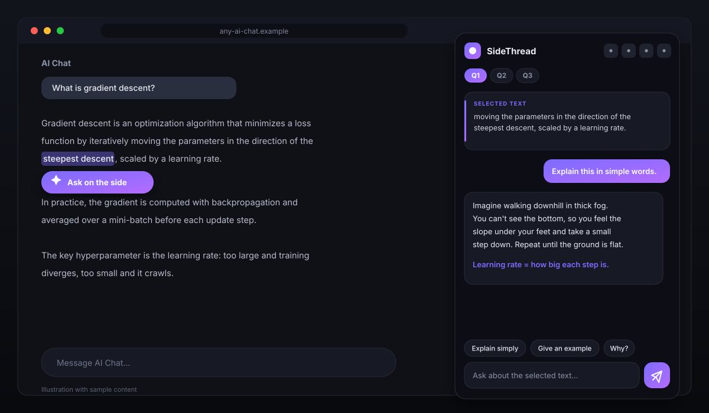
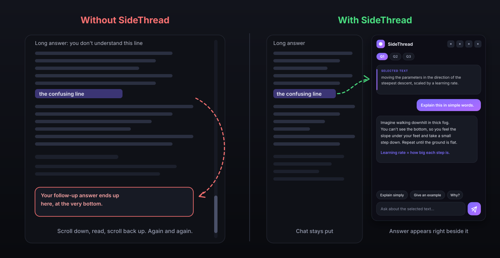
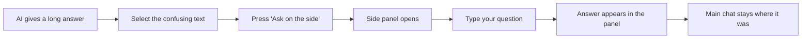
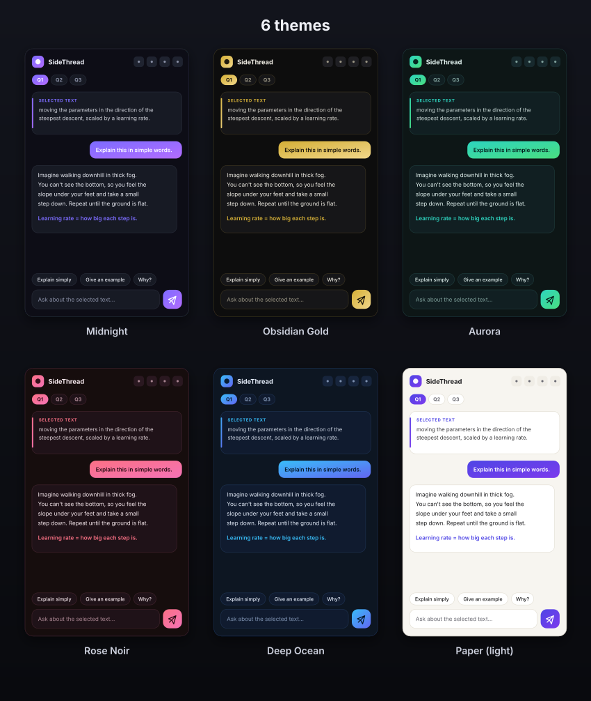
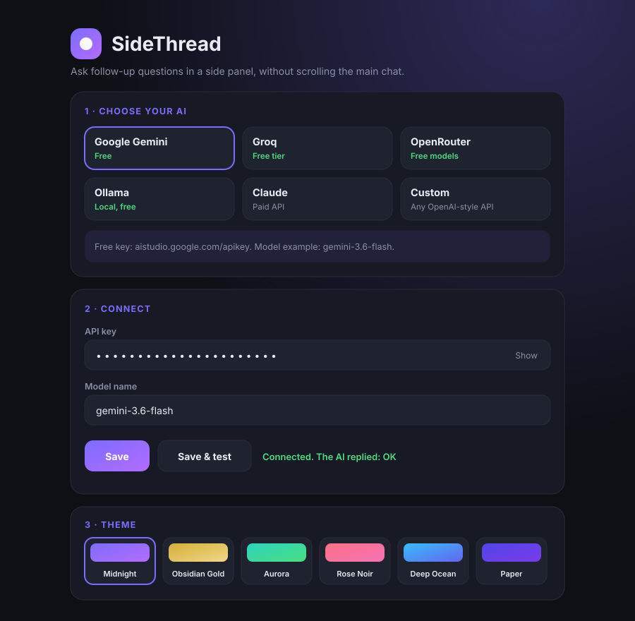

# SideThread

[](LICENSE)
[](manifest.json)

**Ask follow-up questions about any part of an AI answer, in a side panel, without scrolling the main chat.**

A browser extension (Chrome, Edge, Brave) that works on top of any AI chat website: ChatGPT, Claude, Gemini, DeepSeek and more.



*Illustrations in this README use sample content.*

## The problem

When you chat with an AI and don't understand one line of a long answer, you ask a follow-up. The new answer is added at the very **bottom** of the chat, so you have to scroll all the way down, read it, then scroll all the way back up to where you were. Every question makes this worse.



## The solution

Select the confusing text, press **Ask on the side**, and a side panel opens. Each question gets its own space there, with its own mini-conversation. Your main chat never moves.



## Features

- Works on any website, because it runs on the page itself and not inside one specific AI
- Every question gets its own tab (Q1, Q2, Q3...) with its own follow-up chat
- Selected text stays highlighted in the answer, with a "Jump to it" button
- 6 themes: Midnight, Obsidian Gold, Aurora, Rose Noir, Deep Ocean, Paper (light)
- Quick buttons: Explain simply, Give an example, Why?, Summarize
- Resizable panel that can sit on the left or right
- Copy button on every reply, and code blocks and lists display properly
- Export all questions and answers as a Markdown notes file
- Keyboard shortcuts: `Alt+S` toggles the panel, `Esc` closes it
- Questions are saved per chat page, so they are still there when you return
- Friendly error messages (wrong key, rate limit, wrong model name)
- A "Save & test" button on the settings page

### Themes



## Supported AI providers

You bring your own API key. Several options are free.

| Provider | Cost | Notes |
|---|---|---|
| Google Gemini | Free tier | Key from [aistudio.google.com](https://aistudio.google.com/apikey) |
| Groq | Free tier | Key from [console.groq.com](https://console.groq.com/keys) |
| OpenRouter | Some models free | Pick a model ending in `:free` |
| Ollama | Free, runs locally | No key, works offline |
| Claude (Anthropic API) | Paid | Claude chat plans do not include API access |
| Custom | Varies | Any OpenAI-compatible API |

Free tiers and model names change over time. Check each provider for current limits.

## Install

1. Download or clone this repository.
2. Open `chrome://extensions` (or `edge://extensions`).
3. Turn on **Developer mode**.
4. Click **Load unpacked** and select the folder that directly contains `manifest.json`.
5. Click the SideThread icon, choose a provider, paste your API key and model name, then click **Save & test**.
6. Refresh your AI chat tab.



## How to use

1. Select any text in an AI answer.
2. Click the **Ask on the side** button that appears.
3. Type a question, or use a quick button.
4. Open the side tab at the screen edge at any time to see all your questions.

## How it works

```
manifest.json     Extension configuration (Manifest V3)
themes.js         Colour themes, shared by the panel and settings page
content.js        Runs on web pages: detects selection, draws the side panel
background.js     Service worker: sends requests to the AI provider
options.html/js   Settings page: provider presets, key, model, theme
icon*.png         Extension icons
```

- `content.js` draws the panel inside a **Shadow DOM**, so the website's own styles cannot break it.
- Highlights use the browser's CSS Custom Highlight API, so the page's text is never modified.
- Each question sends the selected passage plus surrounding text as context, then your follow-up messages.
- Requests go from `background.js` directly to the provider you choose. There is no SideThread server.
- Threads and settings are stored with `chrome.storage.local`.

## Privacy

- Your API key is stored only in your browser and sent only to the provider you select.
- The selected text and its surrounding context are sent to that provider to answer your question.
- On some free tiers, providers may use submitted content to improve their products. Don't highlight passwords or private documents.
- The extension requests access to all sites so the select-to-ask button can work on any AI website. It only reads text you select.

## Limitations

- Desktop Chromium browsers only (Chrome, Edge, Brave)
- Answers appear all at once, not word by word
- Highlights disappear when the page is reloaded, though the questions remain saved
- Not yet tested on every AI website, so site-specific bugs are possible

## Roadmap

- Streaming answers
- "Ask about the whole answer" button
- Disable on specific sites
- Firefox support

## Contributing

Issues and pull requests are welcome.

## License

This project is licensed under the MIT License - see the [LICENSE](LICENSE) file for details.
